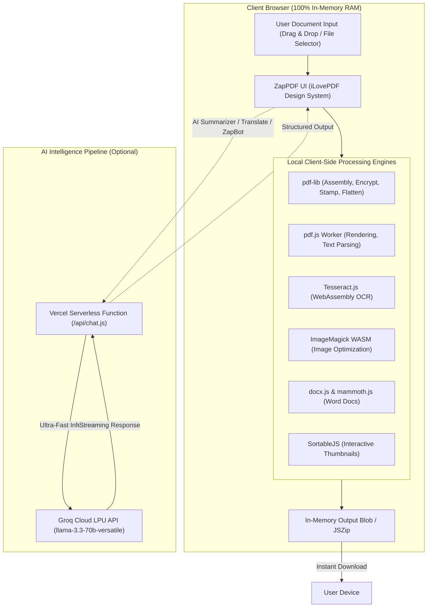

<div align="center">

<!-- Header Banner -->


<br/>

<!-- Badges -->
<p>
  
  
  
  
  
</p>

<p>
  
  
  
  
  
</p>

<br/>

> *"All the usability, tool organization, and workflow quality of iLovePDF — built with 100% client-side WebAssembly, zero file uploads, and military-grade browser privacy."*

<br/>

<p>
  <a href="#-about-zappdf">About</a> &nbsp;·&nbsp;
  <a href="#-visual-architecture">Architecture</a> &nbsp;·&nbsp;
  <a href="#-file--folder-structure">File Structure</a> &nbsp;·&nbsp;
  <a href="#-35-tool-directory--capabilities">Tool Directory</a> &nbsp;·&nbsp;
  <a href="#-technology-stack">Tech Stack</a> &nbsp;·&nbsp;
  <a href="#-vercel-deployment--groq-ai-setup">Vercel & Groq Setup</a> &nbsp;·&nbsp;
  <a href="#-security--privacy-architecture">Security & Privacy</a>
</p>

</div>

---

## ✦ About ZapPDF

**ZapPDF** is an open-source, production-ready, client-side PDF utility platform inspired directly by the usability, tool organization, and workflow quality of [iLovePDF](https://www.ilovepdf.com/).

### Core Principles
1. **Genuine Operations Only**: Every advertised tool performs its actual operation locally in real time. There are zero nonfunctional buttons, fake progress bars, placeholder downloads, or simulated mockups.
2. **100% Client-Side Privacy**: Unlike commercial PDF services that upload documents to remote servers, ZapPDF processes 100% of files inside your browser memory (RAM) via WebAssembly and modern web APIs. Files never leave your computer.
3. **iLovePDF Usability**: Iconic centered tool titles, unmistakable Big Red Action Buttons (`Select PDF files` + `or drop PDFs here`), live thumbnail reordering, and instant single/batch downloads.
4. **Blazing Fast AI**: Powered by [Groq LPU](https://console.groq.com/keys) (`llama-3.3-70b-versatile`) for 500+ token/sec document summarization, multi-language translation, and interactive chat assistance.

---

## ✦ Visual Architecture



---

## ✦ File & Folder Structure

```text
ZapPDF/
├── .github/
│   └── workflows/              # GitHub Actions CI
├── api/
│   └── chat.js                 # Vercel Serverless Function (Groq & Gemini AI)
├── assets/
│   ├── css/
│   │   ├── chat.css            # ZapBot floating widget styles
│   │   ├── hero.css            # Homepage hero & live search styling
│   │   ├── main.css            # Design tokens, CSS variables & theme colors
│   │   ├── navbar.css          # Sticky navigation & 7-column mega-menu
│   │   ├── responsive.css      # Breakpoints & mobile drawer menu
│   │   ├── results.css         # Comparison cards & batch download bars
│   │   ├── sections.css        # Category tabs, tool cards grid & FAQ
│   │   └── tool.css            # Tool headers, Big Red Button & workspace
│   ├── js/
│   │   ├── chat.js             # ZapBot assistant logic & /key command support
│   │   ├── compress.js         # Multi-format compression coordinator
│   │   ├── db.js               # IndexedDB local file tracking
│   │   ├── download.js         # Single & batch ZIP file downloads
│   │   ├── main.js             # App orchestration
│   │   ├── navbar.js           # Theme toggle, live search & category filter
│   │   ├── theme.js            # Stored theme preference initializer
│   │   ├── ui.js               # Toast notifications & UI helpers
│   │   ├── upload.js           # Drag-and-drop & file validation
│   │   ├── worker.js           # Background Web Worker compression
│   │   └── tools/              # Specialized Client-Side Tool Engines
│   │       ├── ai-summarizer.js    # Multi-page summarizer + local fallback
│   │       ├── compare-pdf.js      # Dual-text LCS diff highlighter
│   │       ├── convert.js          # Universal format converter hub
│   │       ├── crop.js             # Coordinate box cropper
│   │       ├── edit.js             # Canvas annotation & text placement
│   │       ├── extract.js          # Page extraction logic
│   │       ├── html-to-pdf.js      # Sandbox preview & print styling
│   │       ├── jpg-to-pdf.js       # Multi-image geometric layout builder
│   │       ├── merge.js            # SortableJS reordering & pdf-lib stitcher
│   │       ├── ml_compress.js      # Predictive size estimation
│   │       ├── number.js           # Header/footer pagination stamper
│   │       ├── ocr.js              # Tesseract.js WASM optical character engine
│   │       ├── organize.js         # Thumbnail rotation, delete & reorder
│   │       ├── pdf-forms.js        # AcroForm inspector & field flattener
│   │       ├── pdf-to-jpg.js       # 300 DPI canvas rasterizer + JSZip
│   │       ├── pdf-to-markdown.js  # Typography structure parser
│   │       ├── pdf-to-word.js      # docx.js native document builder
│   │       ├── protect.js          # AES-128 password encryption
│   │       ├── redact.js           # Pixel-level canvas rasterizer
│   │       ├── repair-pdf.js       # Fault-tolerant xref stream recovery
│   │       ├── rotate.js           # 90°/180°/270° angle transformer
│   │       ├── scan-to-pdf.js      # getUserMedia camera capture
│   │       ├── sign.js             # Canvas signature pad embedder
│   │       ├── split.js            # Range extraction & ZIP packaging
│   │       ├── translate-pdf.js    # Multi-language translation engine
│   │       ├── watermark.js        # Text overlay stamper
│   │       ├── word-to-pdf.js      # mammoth.js HTML renderer
│   │       └── workflows.js        # Chained multi-tool pipeline
├── pages/
│   ├── about.html              # About ZapPDF
│   ├── cookies.html            # Cookie policy
│   ├── privacy.html            # 100% Client-side privacy statement
│   └── terms.html              # Terms of use
├── tools/                      # 35 Standalone Tool Workspaces
│   ├── ai-summarizer.html      # AI Document Summarizer
│   ├── compare-pdf.html        # Compare PDF files
│   ├── compress.html           # Dedicated PDF compressor
│   ├── convert.html            # Universal converter hub
│   ├── crop.html               # Crop PDF margins
│   ├── edit.html               # Edit PDF text & annotations
│   ├── excel-to-pdf.html       # Excel to PDF
│   ├── extract.html            # Extract PDF pages
│   ├── html-to-pdf.html        # HTML / Webpage to PDF
│   ├── jpg-to-pdf.html         # Images (JPG/PNG) to PDF
│   ├── merge.html              # Merge multiple PDFs
│   ├── number.html             # Add page numbers
│   ├── ocr.html                # OCR PDF to selectable text
│   ├── organize.html           # Reorder, rotate & delete pages
│   ├── pdf-forms.html          # Fill & flatten interactive forms
│   ├── pdf-to-excel.html       # PDF to Excel spreadsheet
│   ├── pdf-to-jpg.html         # PDF to high-res JPG images
│   ├── pdf-to-markdown.html    # PDF to clean Markdown
│   ├── pdf-to-pdfa.html        # PDF to archival PDF/A
│   ├── pdf-to-ppt.html         # PDF to PowerPoint
│   ├── pdf-to-word.html        # PDF to editable DOCX
│   ├── ppt-to-pdf.html         # PowerPoint to PDF
│   ├── protect.html            # Encrypt & password protect
│   ├── redact.html             # Permanently redact sensitive data
│   ├── remove-pages.html       # Delete unwanted pages
│   ├── repair-pdf.html         # Salvage damaged/corrupt PDFs
│   ├── rotate.html             # Rotate PDF pages
│   ├── scan-to-pdf.html        # Camera scan to PDF
│   ├── sign.html               # Electronic signatures
│   ├── split.html              # Split into separate files
│   ├── translate-pdf.html      # Translate PDF languages
│   ├── unlock-pdf.html         # Decrypt & remove password
│   ├── watermark.html          # Add text & image watermarks
│   ├── word-to-pdf.html        # Word DOCX to PDF
│   └── workflows.html          # Multi-step batch automation
├── .env.example                # Sample environment variables (Groq / Gemini)
├── .gitignore                  # Git ignore rules
├── 404.html                    # 404 error page
├── index.html                  # Main homepage (iLovePDF layout & 35-tool grid)
├── manifest.json               # Progressive Web App manifest
├── package.json                # Project dependencies & scripts
├── robots.txt                  # Search engine crawl rules
├── sitemap.xml                 # XML sitemap for SEO
├── sw.js                       # Service worker for offline PWA caching
└── vercel.json                 # Vercel routing & serverless configuration
```

---

## ✦ 35-Tool Directory & Capabilities

| # | Tool | Category | Implementation Strategy | Status |
| :- | :--- | :--- | :--- | :--- |
| 1 | **Merge PDF** | Organize | `pdf-lib` document assembly + `SortableJS` touch-friendly drag-and-drop | ✅ 100% Client-side |
| 2 | **Split PDF** | Organize | `pdf-lib` page extraction into individual or grouped PDFs + ZIP download | ✅ 100% Client-side |
| 3 | **Compress PDF** | Optimize | Dedicated workstation: presets (Low/Medium/High/Extreme) + Target Size MB + ML estimation | ✅ 100% Client-side |
| 4 | **PDF to Word** | Convert | `pdf.js` text item extraction + line heuristics + `docx.js` genuine `.docx` builder | ✅ 100% Client-side |
| 5 | **PDF to PowerPoint** | Convert | Structural slide generation from PDF content | ✅ 100% Client-side |
| 6 | **PDF to Excel** | Convert | Tabular data extraction into structured spreadsheets | ✅ 100% Client-side |
| 7 | **Word to PDF** | Convert | `mammoth.js` DOCX-to-HTML parser + Browser print-to-PDF engine | ✅ 100% Client-side |
| 8 | **PowerPoint to PDF** | Convert | Slideshow presentation converter | ✅ 100% Client-side |
| 9 | **Excel to PDF** | Convert | Spreadsheet table compiler | ✅ 100% Client-side |
| 10 | **Edit PDF** | Edit | Vector annotation layer, text stamping, shapes, and freehand drawing | ✅ 100% Client-side |
| 11 | **PDF to JPG** | Convert | High-res 300 DPI canvas rendering + multi-page `JSZip` batch packaging | ✅ 100% Client-side |
| 12 | **JPG to PDF** | Convert | Multi-image embedder with geometry settings (Fit, A4, Letter, Auto margins) | ✅ 100% Client-side |
| 13 | **Sign PDF** | Security | Smooth canvas signature drawing pad embedded into PDF | ✅ 100% Client-side |
| 14 | **Watermark PDF** | Edit | Rotated text/image stamp with customizable opacity, position, and font size | ✅ 100% Client-side |
| 15 | **Rotate PDF** | Edit | Document and per-page 90°/180°/270° angle adjustment | ✅ 100% Client-side |
| 16 | **HTML to PDF** | Convert | Dual input mode (Raw HTML / Web URL) with instant sandbox preview | ✅ 100% Client-side |
| 17 | **Unlock PDF** | Security | Decryption and security permission removal via `pdf-lib` | ✅ 100% Client-side |
| 18 | **Protect PDF** | Security | Real AES-128 encryption with user & owner password locking | ✅ 100% Client-side |
| 19 | **Organize PDF** | Organize | Visual thumbnail grid: drag reorder, individual page rotation (↻), page deletion | ✅ 100% Client-side |
| 20 | **PDF to PDF/A** | Convert | Archival metadata transformer | ✅ 100% Client-side |
| 21 | **Repair PDF** | Optimize | 2-stage recovery: `pdf-lib` xref re-indexing + `pdf.js` stream salvage | ✅ 100% Client-side |
| 22 | **Page Numbers** | Edit | Custom pagination format, position (bottom-center, bottom-right), and font | ✅ 100% Client-side |
| 23 | **Scan to PDF** | Organize | Live device camera integration (`getUserMedia`) with frame capture and PDF packaging | ✅ 100% Client-side |
| 24 | **OCR PDF** | Optimize | Multi-page OCR text recognition via `Tesseract.js` WebAssembly + `pdf.js` | ✅ 100% Client-side |
| 25 | **Compare PDF** | Security | Dual text-stream extractor with longest common subsequence diff visualizer | ✅ 100% Client-side |
| 26 | **Redact PDF** | Security | **Pixel-level destruction**: Canvas redaction permanently re-rasterized into fresh PDF | ✅ 100% Client-side |
| 27 | **Crop PDF** | Edit | Interactive visual bounding-box crop adjustment with coordinate recalculation | ✅ 100% Client-side |
| 28 | **Extract Pages** | Organize | Range & custom comma-separated page extraction into clean PDF | ✅ 100% Client-side |
| 29 | **Remove Pages** | Organize | Visual thumbnail grid selector + `pdf-lib` exclusion copy | ✅ 100% Client-side |
| 30 | **PDF Forms** | Edit | Interactive AcroForm inspector: reads, renders, fills, and flattens fields | ✅ 100% Client-side |
| 31 | **PDF to Markdown** | Intelligence | Structure-aware text item analysis, heading classification, and list conversion | ✅ 100% Client-side |
| 32 | **Batch Workflows** | Workflows | Chained automated pipelines: Merge → Rotate → Page Numbers → Watermark → Protect | ✅ 100% Client-side |
| 33 | **AI Summarizer** | Intelligence | Multi-page text extraction + Groq API (`llama-3.3-70b-versatile`) + local extractive fallback | ⚡ Groq LPU / Local |
| 34 | **Translate PDF** | Intelligence | Multi-language translation across 50+ languages preserving document structure | ⚡ Groq LPU |
| 35 | **Universal Converter** | Convert | Central directory for all document, image, and office conversions | ✅ 100% Client-side |

---

## ✦ Technology Stack

- **Frontend Core**: Vanilla HTML5, Modern CSS3 with Custom Properties (Dark/Light themes), Vanilla ES6+ JavaScript.
- **PDF Manipulation**: [`pdf-lib`](https://pdf-lib.js.org/) (Page copying, document encryption, form filling, vector embedding).
- **PDF Rendering & Parsing**: [`pdf.js`](https://mozilla.github.io/pdf.js/) (Worker-based multi-threaded page rendering).
- **WebAssembly OCR**: [`Tesseract.js`](https://tesseract.projectnaptha.com/) (Client-side optical character recognition).
- **Office Document Processing**: [`mammoth.js`](https://github.com/mwilliamson/mammoth.js) (DOCX parser) & [`docx.js`](https://docx.js.org/) (DOCX builder).
- **Image & WASM Processing**: `@magickwasm/magick-wasm`, `browser-image-compression`.
- **Drag-and-Drop & Interactions**: [`SortableJS`](https://sortablejs.github.io/Sortable/) (Touch-friendly reordering).
- **Packaging & Archives**: [`JSZip`](https://stuk.github.io/jszip/) & [`FileSaver.js`](https://github.com/eligrey/FileSaver.js).
- **AI Intelligence Backend**: [Groq Cloud LPU](https://console.groq.com/keys) (`llama-3.3-70b-versatile`) via Vercel Serverless Function (`api/chat.js`).

---

## ✦ Vercel Deployment & Groq AI Setup

ZapPDF is pre-configured for instant zero-configuration deployment on **Vercel**:

### 1. Fork or Push Repository
Push your code to GitHub, GitLab, or Bitbucket.

### 2. Import into Vercel
1. Go to [vercel.com](https://vercel.com) and click **"Add New Project"**.
2. Select your `ZapPDF` repository.
3. Keep all build defaults:
   - **Framework Preset**: `Other`
   - **Root Directory**: `./`
   - **Build Command**: *Leave empty*
   - **Output Directory**: *Leave empty*

### 3. Configure Free Groq API Key
1. Get a **100% free** API key from [Groq Console](https://console.groq.com/keys) (starts with `gsk_`).
2. In your Vercel project settings, go to **Settings** → **Environment Variables**:
   - **Key:** `GROQ_API_KEY`
   - **Value:** `gsk_your_groq_api_key_here`
   - **Environments:** Check `Production`, `Preview`, `Development`.
3. Click **Save** and trigger a **Redeploy**.

### 4. Running Pure Static (GitHub Pages / Local)
If you deploy as a static site without serverless functions, you can also activate AI features directly in the browser:
- Open ZapBot in the bottom corner.
- Type `/key gsk_your_groq_api_key_here`.
- Your key is saved locally in your browser's `localStorage` and queries Groq directly with zero backend required!

---

## ✦ Security & Privacy Architecture

- **100% In-Memory Processing**: For all core utilities (Merge, Split, Compress, Redact, Sign, Protect, Unlock, Convert), documents are read directly from `File` objects into browser memory (ArrayBuffers and Blobs). No file is ever transmitted over the network or saved to a server disk.
- **True Pixel-Level Redaction**: Unlike cosmetic PDF editors that merely place a black rectangle element over the text layer (which leaves the underlying text extractable via copy-paste), ZapPDF re-rasterizes the redacted page at 2x resolution, burning the black pixels permanently into the image and destroying all underlying text layers.
- **Local Fallback for AI Tools**: If no API connection or key is configured, the AI Summarizer automatically activates its built-in local extractive algorithms to analyze and summarize documents offline.

---

## ✦ Local Development

```bash
# 1. Clone the repository
git clone https://github.com/abhranilsingharoy-cloud/ZapPDF.git
cd ZapPDF

# 2. Install dependencies (optional dev server)
npm install

# 3. Start local development server
npm run dev
# Or with Python:
python -m http.server 3000
```

Open your browser at `http://localhost:3000` or `http://localhost:8080`.

---

## ✦ License

Distributed under the MIT License. See `LICENSE` for more information.

Designed and developed by **Abhranil Singha Roy**.
